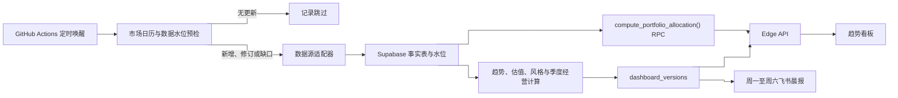

# 趋势观察台架构

本文档描述正式数据管道。Supabase 事实表、数据库计算函数与已发布看板版本共同构成正式事实源。

## V2 目标架构



### V2 目录与职责

```text
supabase/
├── migrations/                                      # RLS、事实表、运行状态与数据库计算函数
├── functions/dashboard-api/index.ts                  # 需 Auth 的只读 Edge API
└── functions/portfolio-config/index.ts               # 登录后配置写入与实时回传
codex/trend_observer/
├── assets.py             # 13 个指数、14 只股票与来源代码映射
├── supabase_store.py     # Supabase REST 仓储、水位、版本与通知记录
├── ingestion.py          # 两交易日重叠的增量行情/估值同步与退避
├── allocation.py         # 单测契约镜像；生产实时配置仅由数据库 RPC 统一计算
├── style_compass.py      # 三组 20/60/120 日收益差、PE 约束与建议原因
├── fundamentals.py       # 高股息四维研究结论（只处理已确认事实）
├── quarterly.py          # 十年季度经营、分红及股利支付率的唯一计算口径
├── quarterly_evidence.py # 核对正式公告文件并导入已审核的财报及分红事实
├── corporate.py          # 财报、分红与行业披露的版本化适配器契约
├── dashboard_versions.py # 不可变看板数据版本
└── dispatch.py           # 周一至周六 08:00 后的版本去重推送
```

### 运行命令

```bash
python -B -m codex.trend_observer.cli bootstrap
python -B -m codex.trend_observer.cli sync-market --market CN
python -B -m codex.trend_observer.cli sync-valuation
python -B -m codex.trend_observer.cli sync-fundamentals --force
python -B -m codex.trend_observer.cli publish-dashboard
python -B -m codex.trend_observer.cli dispatch-feishu
```

`sync-market` 在没有水位时执行历史初始化；之后只请求从数据库最新日期向前重叠两个交易日的窗口。连续三次失败后水位进入退避状态。资金风格建议由 Python 在发布时计算并写入 `dashboard_versions`，包括占优侧投资建议与 PE 百分位不高于 50% 的约束及原因。六类配置的比例、偏离四档、理论调整额与摘要由 `compute_portfolio_allocation()` RPC 实时统一计算，Edge API 与前端只转发和渲染。`dispatch-feishu` 不调用任何行情来源，只读取完整且尚未发送过的 `dashboard_versions`。

股票股息率也由 Python 发布器独占计算：`sync-fundamentals` 保存来源报告期明确的分红事件，发布时按交易日前一报告年度汇总已实施及已批准未实施的税前每股现金分红，再除以当日收盘价。`last_year_dividend`、`dividend_fiscal_year`、`dividend_yield`、状态和缺数原因一并写入版本；Edge、前端和飞书只消费版本。历史 `asset_daily_signals.dividend_yield` 不作为看板股息率依据。旧事件报告期不明时保持缺数，须回填后重新发布。

季度经营与股利支付率同样由 Python 发布器计算。自动同步的财报、分红记录先作为候选事实；两源可比且一致的自动核验，或依据报告公告人工核验后，数值才能进入季度图表和确定的分红合计。同一分红方案跨阶段只保留一个当前版本，原候选记录与正式方案关联后退出当前计算。季度结果随 `dashboard_versions` 保存，Edge 校验登录后仅在对应资产详情返回季度结果；前端只做展示和图表切换。

## 页面与发布

GitHub Pages 只部署 `dashboard_example.html` 及配置、登录、季度展示、运行时四个 JavaScript 文件。看板登录后由 Edge API 读取最新完整的 `dashboard_versions`；打开详情时再按需读取数据库中的历史行情、财务事实、分红事件和该版本的季度结果。缺少认证或 API 不可用时，页面明确显示 Mock 状态，Mock 不代表生产数据。

`deploy_dashboard.yml` 发布静态页面；`trend_observer_v2.yml` 同步事实、发布版本并派发飞书。两条流程各有职责，静态页面发布不会补抓行情或重算历史事实。

## 外部依赖

| 数据源 | API | 用途 |
|--------|-----|------|
| 腾讯 | `web.ifzq.gtimg.cn` | 指数/股票前复权 K 线（历史分段并校验重叠）；股票未复权日线备用源 |
| 东方财富 | `push2his.eastmoney.com` | 股票 K 线（优先） |
| 中证指数 | `csindex.com.cn` | 指数 K 线 + PE |
| 国证指数 | `hq.cnindex.com.cn` | 国证自由现金流指数 |

飞书通知依赖环境变量 `FEISHU_WEBHOOK_URL`（必填）和 `FEISHU_SECRET`（可选签名）。

## 发布检查与详情区域读取

Python 发布器先通过 `begin_dashboard_publication` 获得有期限的数据库租约及输入修订号，再读取事实并计算。所有发布输入的业务变化通过触发器递增修订号；事实表仅核实过程元数据变化不触发重算。`finish_dashboard_publication` 在同一数据库事务中核对租约、输入修订号和完整性，写入或复用不可变内容版本，并更新当前版本指针与检查记录；输入变化或全局错误时失败，后续检查重算。局部来源失败按既有资产降级规则展示。

`dashboard_batches` 登记早间、晚间或手动批次及上游任务终态；`dashboard_publication_checks` 留存尝试、成功检查时间及输入修订号。07:30早间批次、20:30晚间批次在各自依赖完成后发布。早报独立按当日早间成功检查就绪，按业务日期和消息类型去重。运行状态通过只允许服务端调用的 `dashboard_runtime_status` RPC 提供，由已鉴权 Edge API 转发。

资产详情保留兼容的整包入口，并支持分区域请求。前端以资产、快照版本、区域和行情区间缓存；基本面不等待行情查询，区域更新保留页签及当前选择，过期请求不得重开弹窗。季度图表和金额明细仅格式化 Python 发布值，尚未披露与已披露缺数由后端状态区分。上市日期通过一次性元数据同步入库，带来源文档引用；日期不明时保留年份并说明原因。


## 季度核实链路

`FundamentalSynchronizer` → `review_observe` 保存来源观察；当前采用事实及旧版本留在既有事实表。`review_data` 保存比较结果与方式；`review_events` 追加保存观察、修改、核实、尝试及发布回执。浏览器通过登录校验的 `quarterly-review` Edge 调用有限操作事务，不能上报自动 verified。

本地 `verification.py` 领取 verification 任务，串行调用既有 Wind Node CLI，按证券、季度、口径、单位、币种、修订与精度比较，回执绑定事实哈希、任务、尝试和租约。失败/异常保持 candidate；源自身新版本使已核实事实失效，重新进入流程。`review_jobs` 只保留每对象的当前尝试，历史尝试及结果由不可变追加事件保存。

`dividend_year_reviews` 独立跟踪全年完整性。季度事实与年度查全分别计数；未来及未披露年度只等待。单笔方案变动使年度依据失效。全年度零不能由“查询不到”推断。

`review_revision` 仅跟踪会影响发布的变更。Python快照声明各单季、年度、同比及分红节点的事实依赖；Edge只按实时失效事件遮蔽旧值，不复制金融计算。发布时重新调用既有 Python 研究摘要规则且只消费当前 verified 事实。通知在发现版本之后有失效事件时等待重算。旧快照没有依赖契约时，对该股票季度区整体隐藏，直到新快照发布。

“更新看板”由 Edge 触发既有 GitHub 工作流，云端领取 publish 请求后复用 `DashboardPublisher` 和原发布围栏。与本地 Wind 执行器无耦合；未知配置、未启动及执行失败均可追溯并重试。数据库迁移、Edge、Python、Pages及首个新快照均为上线依赖；本分支隔离测试不替代生产验收。
