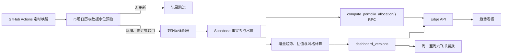

# 趋势观察台架构

本文档描述正式数据管道。Supabase 事实表、数据库计算函数与已发布看板版本共同构成正式事实源。

## V2 目标架构



### V2 目录与职责

```text
supabase/
├── migrations/                                      # RLS、事实表、运行状态与数据库计算函数
├── functions/dashboard-api/index.ts                  # 需 Auth 的只读 Edge API
└── functions/portfolio-config/index.ts               # editor 配置写入与实时回传
codex/trend_observer/
├── assets.py             # 12 个指数、14 只股票与来源代码映射
├── supabase_store.py     # Supabase REST 仓储、水位、版本与通知记录
├── ingestion.py          # 两交易日重叠的增量行情/估值同步与退避
├── allocation.py         # 单测契约镜像；生产实时配置仅由数据库 RPC 统一计算
├── style_compass.py      # 三组 20/60/120 日收益差、PE 约束与建议原因
├── fundamentals.py       # 高股息四维研究结论（只处理已确认事实）
├── corporate.py          # 财报、分红与行业披露的版本化适配器契约
├── dashboard_versions.py # 不可变看板数据版本
└── dispatch.py           # 周一至周六 08:00 后的版本去重推送
```

### 运行命令

```bash
python -B -m codex.trend_observer.cli bootstrap
python -B -m codex.trend_observer.cli sync-market --market CN
python -B -m codex.trend_observer.cli sync-valuation
python -B -m codex.trend_observer.cli sync-fundamentals --force
python -B -m codex.trend_observer.cli publish-dashboard
python -B -m codex.trend_observer.cli dispatch-feishu
```

`sync-market` 在没有水位时执行历史初始化；之后只请求从数据库最新日期向前重叠两个交易日的窗口。连续三次失败后水位进入退避状态。资金风格建议由 Python 在发布时计算并写入 `dashboard_versions`，包括占优侧投资建议与 PE 百分位不高于 50% 的约束及原因。六类配置的比例、偏离四档、理论调整额与摘要由 `compute_portfolio_allocation()` RPC 实时统一计算，Edge API 与前端只转发和渲染。`dispatch-feishu` 不调用任何行情来源，只读取完整且尚未发送过的 `dashboard_versions`。

股票股息率也由 Python 发布器独占计算：`sync-fundamentals` 保存来源报告期明确的分红事件，发布时按交易日前一报告年度汇总已实施且已除息的每股现金分红，再除以当日收盘价。`last_year_dividend`、`dividend_fiscal_year`、`dividend_yield`、状态和缺数原因一并写入版本；Edge、前端和飞书只消费版本。历史 `asset_daily_signals.dividend_yield` 不作为看板股息率依据。旧事件报告期不明时保持缺数，须回填后重新发布。

## 页面与发布

GitHub Pages 只部署 `dashboard_example.html` 及配置、登录、运行时三个 JavaScript 文件。看板登录后由 Edge API 读取最新完整的 `dashboard_versions`；打开详情时再按需读取数据库中的历史行情、财务事实和分红事件。缺少认证或 API 不可用时，页面明确显示 Mock 状态，Mock 不代表生产数据。

`deploy_dashboard.yml` 发布静态页面；`trend_observer_v2.yml` 同步事实、发布版本并派发飞书。两条流程各有职责，静态页面发布不会补抓行情或重算历史事实。

## 外部依赖

| 数据源 | API | 用途 |
|--------|-----|------|
| 腾讯 | `web.ifzq.gtimg.cn` | 指数/股票前复权 K 线（历史分段并校验重叠）；股票未复权日线备用源 |
| 东方财富 | `push2his.eastmoney.com` | 股票 K 线（优先） |
| 中证指数 | `csindex.com.cn` | 指数 K 线 + PE |
| 国证指数 | `hq.cnindex.com.cn` | 国证自由现金流指数 |

飞书通知依赖环境变量 `FEISHU_WEBHOOK_URL`（必填）和 `FEISHU_SECRET`（可选签名）。
